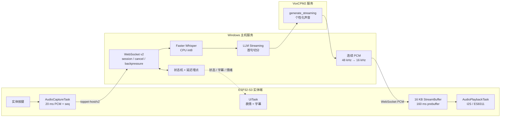

# TopPet

**ESP32-S3 实体 AI 桌宠：一个可打断、可观测、可实测的端到端流式语音系统。**

> **ESP32-S3 → 20 ms PCM → Faster Whisper → LLM Streaming → VoxCPM2 → WebSocket PCM → I2S Playback**


TopPet 不是把聊天接口装进屏幕的 Demo。它把实体按键、麦克风、动画状态机、本地 ASR、流式 LLM、个性化 TTS、WebSocket 音频协议和 I2S 播放串成了一条真实硬件链路，并为每个阶段记录延迟、缓冲水位、会话与错误指标。

**当前结论：功能闭环和链路可靠性已通过 30 轮实体设备验收；低延迟与连续播放性能尚未通过。** 失败指标被保留为下一轮优化基线，而不是用更大的缓冲区掩盖。

## 实测证据

测试于 2026-08-23 在 ESP32-S3 实体设备、Windows 主机和本地 VoxCPM2 服务上完成。30 轮分别注入 1、3、5 秒 PCM，覆盖完整的上传、识别、生成、合成和播放完成事件。

| 验收项 | 实测结果 | 判定 |
| --- | ---: | --- |
| 完整播放 | **30/30 轮** | 通过 |
| 崩溃 / 缓冲溢出 / PCM 乱序 / 迟到帧 | **0 / 0 / 0 / 0** | 通过 |
| 首声延迟 | **P50 2549 ms / P95 3535 ms** | 未通过目标 1500 / 2200 ms |
| 播放欠载 | **14/30 轮，共 251 次** | 未通过零欠载目标 |
| VoxCPM2 热态持续生成 | **RTF 1.071** | 未通过；生成慢于播放 |

这 30 轮证明了协议和会话链路的稳定性，不等同于 30 轮真人声学准确率测试。最终麦克风距离、识别准确率、扬声器听感、物理打断延迟和 8 小时长稳仍需专项验收。完整样本、环境与逐轮数据见 [低延迟实测报告](docs/latency-report.md)。

## 这项工作解决了什么

- **真实设备协议**：ESP32-S3 以 20 ms、640 字节的 `16 kHz / 16-bit / mono` PCM 帧持续上传；主机校验 `session_id` 和序号，对缺帧补静音，丢弃旧会话与乱序帧。
- **端到端流式编排**：LLM 生成完整句后立即触发 TTS；VoxCPM2 输出连续裸 PCM，主机使用有状态增量重采样从 48 kHz 转为 16 kHz，不等待整段回复完成。
- **可打断的状态机**：`IDLE → LISTENING → THINKING → TALKING → IDLE` 与会话生命周期绑定；新会话会取消旧推理并清空过期字幕和音频。
- **嵌入式并发**：采集、网络、播放和 UI 使用独立任务；16 KB 播放缓冲在 160 ms 预缓冲后启动 I2S，并通过高低水位和 TCP 反压控制数据流。
- **可审计性能**：同时测量 ASR、LLM 首 token/首句、TTS 首块、设备首个 I2S 写入、RTF、欠载和缓冲水位，能定位瓶颈属于网络、模型还是设备播放端。

## 系统架构



高算力推理全部在主机端完成；ESP32-S3 只承担确定性的采集、显示、网络与播放职责。这个边界让 ASR、LLM 或 TTS 可以独立替换，只要保持连续 PCM、音频格式头、首块流式输出和取消语义不变。

## 关键工程决策

### 1. 连续 PCM，而不是分块 WAV

每个 TTS 块都封装 WAV 头会制造边界噪声，也会让设备端解析变复杂。VoxCPM2 服务直接返回连续 `pcm_s16le`；主机保留重采样器状态，ESP32 收到的每个二进制块都属于同一条连续音频流。

### 2. 会话隔离优先于“尽量播放”

音频、字幕和状态事件都带会话 ID。取消后到达的旧模型回调会被丢弃；新一轮按键先清空旧缓冲，避免桌宠把上一轮回答接到新问题后面。

### 3. 不用扩大缓冲掩盖吞吐不足

热态 RTF 为 1.071，意味着 TTS 每生成 1 秒音频需要约 1.071 秒。有限的 160 ms 预缓冲必然被耗尽；单纯加大缓冲只能用更高首声延迟换取暂时连续。当前优化优先级是降低 LLM 首句延迟，并把持续 RTF 压到 1 以下，工程目标为 0.7 以下。

### 4. 故障必须能恢复

长连接实现 WebSocket ping/pong 和自动重连；TTS 生产线程通过队列与 HTTP 消费者解耦，客户端断开也会释放 GPU 锁；协议对缺帧、乱序、迟到帧和旧会话都有显式处理。

## 代码地图

| 目录 | 责任 |
| --- | --- |
| [`firmware/`](firmware/) | ESP32-S3 音频采集、WebSocket v2、I2S 播放、表情与字幕 |
| [`host_service/`](host_service/) | 主机 API、会话编排、流式管线、播放策略与延迟埋点 |
| [`audio/`](audio/) | Faster Whisper、VoxCPM2/EdgeTTS 适配与本地播放 |
| [`core/`](core/) | LLM 客户端、对话、长期记忆和流式分句 |
| [`systems/`](systems/) | 状态、情绪、角色映射和模型服务生命周期 |
| [`tests/`](tests/) | 协议、取消、重连、PCM 连续性、角色隔离与兼容性测试 |
| [`tools/`](tools/) | ASR 基准、角色检查和 30 轮硬件验收工具 |

更详细的依赖方向见 [架构文档](docs/architecture.md)，产品需求、异常策略与 EVT/DVT/PVT 验收基线见 [产品规格](docs/product-spec.md)。

## 快速运行

开发环境以 Windows、PowerShell 和 Python 3.11 为基线。

```powershell
python -m venv .venv
.\.venv\Scripts\Activate.ps1
python -m pip install -r requirements.txt
$env:DEEPSEEK_API_KEY = "your-api-key"
python laoshaozi.py --character personal
```

启动实体设备使用的主机服务：

```powershell
powershell -ExecutionPolicy Bypass -File host_service\start.ps1
Invoke-RestMethod http://127.0.0.1:8765/health
```

连接微雪 `ESP32-S3-Touch-AMOLED-2.16` 后编译或烧录：

```powershell
powershell -ExecutionPolicy Bypass -File firmware\build_and_upload.ps1 -CompileOnly
powershell -ExecutionPolicy Bypass -File firmware\build_and_upload.ps1 -Port COM5
```

完整个性化声音链路当前依赖同机的 VoxCPM2 companion checkout，默认路径仍为 `D:\VoxCPM2`；这部分尚未做到跨机器一键安装。部署与模型服务契约见 [VoxCPM2 声音文档](docs/voxcpm2-voice.md)，网络协议见 [主机服务文档](docs/host-service.md)，固件工具链与配网见 [固件说明](firmware/README.md)。

## 验证

```powershell
python -m pytest -q
python tools/check_character.py

# 连接实体设备后复跑 30 轮注入式验收
python tools/hardware_acceptance.py `
  --port COM5 --rounds 30 --durations 1 3 5 --inject `
  --output artifacts/hardware-acceptance.json
```

当前 TopPet 测试集为 `71 passed + 23 subtests`；2026-08-23 硬件验收同时记录了 VoxCPM2 独立服务 `2 passed`。测试覆盖连续 PCM、增量重采样、分句并行、取消、迟到帧、v1/v2 协议、重连、序号异常、缓冲策略、字幕时序和角色隔离。

## 当前边界与下一步

| 优先级 | 当前边界 | 完成标准 |
| --- | --- | --- |
| P0 | LLM 首句 P95 2016 ms | 更低延迟端点、本地小模型或可靠 partial ASR |
| P0 | VoxCPM2 热态 RTF 1.071 | 持续 RTF < 1，目标 < 0.7；30 轮零欠载 |
| P1 | 物理打断缺少毫秒级硬件证据 | 设备回传 `playback_aborted` 时间戳并实测 |
| P1 | 声学、续航、温升和 8 小时长稳未完成 | 使用最终外壳与扬声器完成整机验收 |

## 公开发布状态

当前仓库仍是 EVT 工程快照，不应被表述为量产或生产可用产品。正式公开发布前还需要：

- 为源代码选择项目级 `LICENSE`；在此之前不能假定代码已获开源授权。
- 用原创或已授权角色替换 `shinchan` 等展示素材，并确认参考音频的授权范围。
- 通过 `THIRD_PARTY_NOTICES.md` 分开说明代码、原创素材、第三方素材和模型许可证。
- 将 Whisper 权重从仓库主体移出，改为安装脚本按需下载。
- 发布包含实体样机视频、硬件/模型版本和指标表的 GitHub Release。

## 文档索引

- [低延迟实测报告](docs/latency-report.md)：30 轮原始指标、环境、失败分析
- [产品规格](docs/product-spec.md)：使用场景、状态规范、硬件基线、验收定义
- [系统架构](docs/architecture.md)：模块边界与依赖方向
- [主机服务](docs/host-service.md)：HTTP/WebSocket 协议与音频格式
- [VoxCPM2 声音](docs/voxcpm2-voice.md)：本地声音服务、参考音频与验证
- [硬件检查清单](docs/hardware-checklist.md)：采购、装配与安全验收
