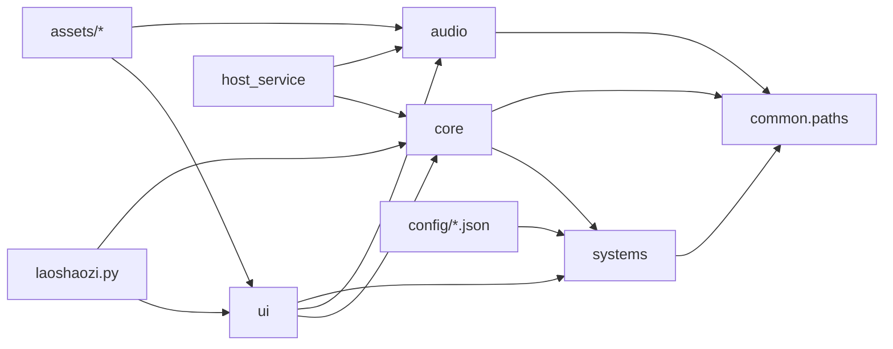

# 项目结构与模块边界

## 依赖方向

`common` 必须保持轻量且不能反向导入其他应用包，这样所有层都可以安全复用项目路径。`core` 负责与界面无关的应用逻辑；`systems` 负责可复用的状态、情绪、角色映射和外部服务生命周期；`ui` 只处理窗口、事件和展示；`audio` 封装语音输入输出；`host_service` 只负责网络协议和主机端编排，不复制对话或角色逻辑。

## 文件放置规则

- 新角色：优先创建 `characters/<角色 ID>/` 角色包，在其中放置 `character.json`、`expressions/`、可选的 `starter_memory.json` 和声音资源。旧的 `config/` 与 `assets/characters/` 仍作为兼容回退。
- 运行时数据：日志、PID 和本地记忆写入 `logs/`，不要放进源码目录。
- 生成或调试产物：统一写入 `artifacts/`。该目录被 Git 忽略，可以安全重建。
- 可重复运行的开发脚本：放入 `tools/`；一次性修补脚本归档到 `artifacts/legacy_patches/`。
- 文档：放入 `docs/`，根目录只保留入口、依赖清单和项目级配置。
- 端到端人工验证：可以使用 `tests/smoke_*.py`，文件名刻意避开自动测试收集规则。

## 路径约定

所有跨模块路径都由 `common/paths.py` 定义。业务代码不要依赖当前工作目录，也不要再拼接 `__file__` 来猜测项目根目录。这样从 IDE、测试和命令行启动时会得到相同路径。
